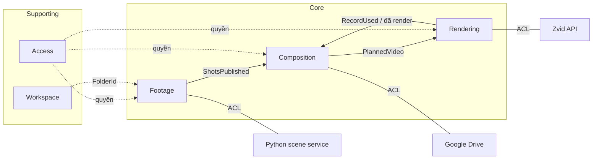
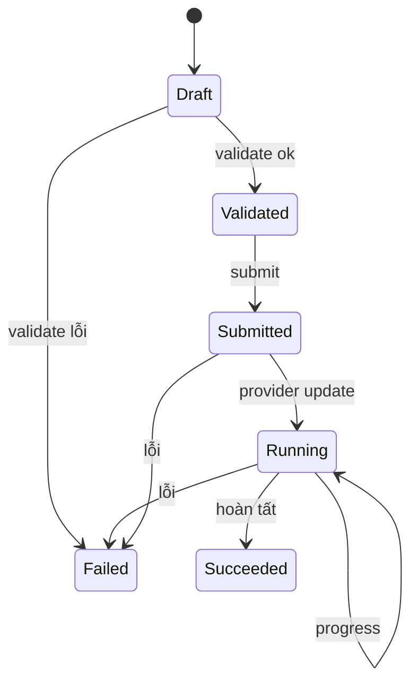
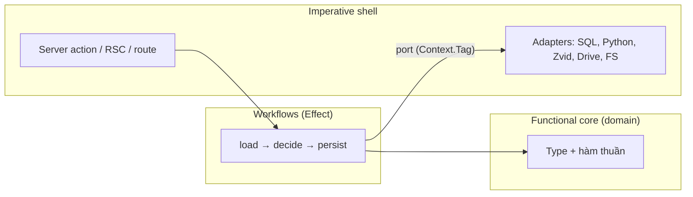
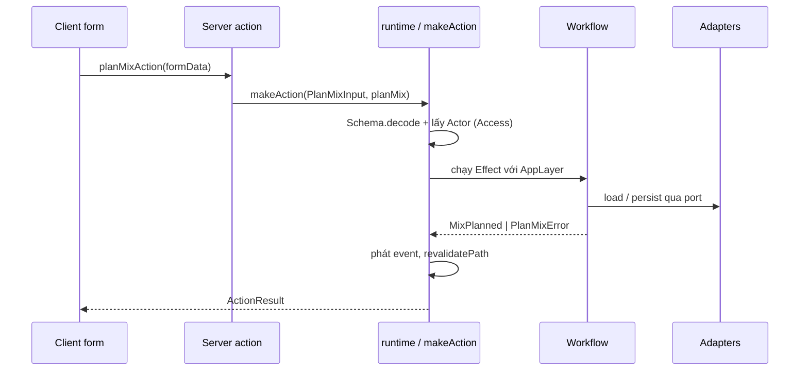

# DMMF + FP trong Lachvid: áp dụng ở đâu và như thế nào

> [!NOTE]
> Code minh hoạ viết theo Effect 3.x (`import { Schema, Data, Effect, ... } from "effect"`). Cú pháp sẽ được chốt lại khi cài thư viện ở P0.4. Tên type/hàm là **bản nháp** để thảo luận ở P1.0.

## Mục lục

1. Tư tưởng cốt lõi
2. Ngôn ngữ chung (ubiquitous language)
3. Bounded context & context map
4. Mô hình hoá bằng type
5. Make illegal states unrepresentable
6. Workflow là pipeline
7. Mô hình hoá lỗi
8. Dependency: functional core, imperative shell
9. Persistence: DTO ↔ domain
10. Giao tiếp giữa các context bằng event
11. Gắn vào Next.js (action, RSC, route)
12. UI React theo phong cách FP
13. Quy tắc FP
14. Chiến lược test
15. Áp dụng cụ thể cho từng context
16. Giới hạn: chỗ nào **không** áp dụng

---

## 1. Tư tưởng cốt lõi

DMMF (Scott Wlaschin) gồm 4 ý chính:

| Ý                                          | Nghĩa                                       | Ở Lachvid hiện tại                                                                        |
| ------------------------------------------ | ------------------------------------------- | ----------------------------------------------------------------------------------------- |
| **Type là tài liệu thiết kế**              | Đọc type là hiểu nghiệp vụ                  | `Shot`, `ComposedVideo` có rất nhiều field optional, đọc không biết trạng thái nào hợp lệ |
| **Trạng thái sai không biểu diễn được**    | Compiler chặn bug thay cho `if` rải rác     | `renderState: "completed"` mà `localOutputUrl` vẫn có thể `null`                          |
| **Nghiệp vụ là pipeline biến đổi dữ liệu** | `Input → validate → decide → Output/Events` | Logic nằm trong 60+ `handleXxx` trong component                                           |
| **I/O đẩy ra rìa**                         | Lõi thuần, rìa có side-effect               | `fetch`, `fs`, SQL trộn lẫn trong route + component                                       |

FP là **cách hiện thực** những ý trên: hàm thuần, dữ liệu bất biến, kết hợp hàm (`pipe`), lỗi là giá trị.

Effect đóng vai trò mà F# có sẵn trong ngôn ngữ:

| F# (sách DMMF)                         | TypeScript + Effect                                   |
| -------------------------------------- | ----------------------------------------------------- |
| Record                                 | `Schema.Struct` / `Data.struct`                       |
| Discriminated union                    | `Data.TaggedEnum` / `Schema.Union` của `TaggedStruct` |
| Single-case union (`ShotId of string`) | `Schema.String.pipe(Schema.brand("ShotId"))`          |
| `Option`, `Result`                     | `Option`, `Either`                                    |
| `match ... with`                       | `Match.type` / `Data.TaggedEnum.$match` (exhaustive)  |
| Async + Result                         | `Effect<A, E, R>`                                     |
| Truyền dependency qua tham số          | `Context.Tag` + `Layer` (ở tầng workflow)             |

---

## 2. Ngôn ngữ chung (bản nháp glossary)

Code hiện tại có **xung đột từ ngữ** nghiêm trọng: trong DB và API, `project` thực chất là **folder**, còn `parent project` mới là **project** người dùng thấy. DMMF yêu cầu sửa ngay ở tầng domain.

| Thuật ngữ (code)   | Tiếng Việt            | Định nghĩa                                                 | Tên cũ trong code                        |
| ------------------ | --------------------- | ---------------------------------------------------------- | ---------------------------------------- |
| `Project`          | Dự án                 | Nhóm cao nhất, có owner, chứa nhiều folder, đơn vị chia sẻ | `ParentProject`, `parent-projects`       |
| `Folder`           | Thư mục làm việc      | Một workspace studio (split/mix/history)                   | `Project`, `ProjectMeta`, `project/[id]` |
| `SourceVideo`      | Video nguồn           | Video gốc được upload để tách                              | `SourceVideo`                            |
| `Scene`            | Cảnh phát hiện        | Đoạn do PySceneDetect trả về, chưa chỉnh                   | `rawBegin/rawEnd`                        |
| `DraftShot`        | Shot nháp             | Shot chưa gán category                                     | `Shot` với `category: null`              |
| `ClassifiedShot`   | Shot đã phân loại     | Shot đã gán category, đủ điều kiện publish                 | `Shot` với `category` khác null          |
| `ShotCategory`     | Nhóm cảnh             | `Open`, `Product`, `Texture`, `Apply`, `End`               | `ShotCategory`                           |
| `MinDuration`      | Thời lượng tối thiểu  | Số giây tối thiểu mỗi category, thiếu thì làm chậm         | `CategoryMinDurations`                   |
| `Clip`             | Clip thư viện         | Một video trong thư viện theo category                     | `CategoryVideoItem`                      |
| `ClipLibrary`      | Thư viện clip         | 5 pool clip theo category                                  | `CategoryPools`                          |
| `VoiceClip`        | Voice                 | File giọng đọc dùng để ghép                                | `MultiVoiceItem`, `VoiceTrack`           |
| `DiversityRules`   | Luật đa dạng          | Số video, Hamming tối thiểu, tần suất tối đa, seed         | `DiversityConfig`                        |
| `CompositionTuple` | Bộ 5 clip             | Một clip cho mỗi category, định danh 1 video ghép          | `tupleKey`, `shotIds`                    |
| `PlannedVideo`     | Video đã lên kế hoạch | Kết quả của plan mix, chưa render                          | `ComposedVideo` (`draft`)                |
| `RenderJob`        | Job render            | Vòng đời render trên Zvid                                  | `ComposedVideo.renderState`              |
| `RenderedRecord`   | Bản ghi đã render     | Lịch sử, đánh dấu `Used`/`Unused`                          | `RenderedVideoRecord`                    |
| `Collaborator`     | Người được chia sẻ    | Người có quyền trên project/folder                         | `role: "shared"`                         |
| `ModulePermission` | Quyền theo module     | Quyền `View`/`Export`/`Edit` trên split/mix/history        | `ModulePermissionConfig`                 |

Glossary này được duyệt ở **P1.0** và trở thành luật đặt tên trong AGENTS.md.

---

## 3. Bounded context & context map



| Quan hệ                                                 | Kiểu                            | Giải thích                                                            |
| ------------------------------------------------------- | ------------------------------- | --------------------------------------------------------------------- |
| Footage → Composition                                   | Customer/supplier qua event     | Footage publish shot đã phân loại, Composition tự chuyển thành `Clip` |
| Composition → Rendering                                 | Customer/supplier               | Rendering nhận `PlannedVideo`, không biết luật đa dạng                |
| Rendering → Composition                                 | Query                           | Planner cần biết tuple nào đã render để tránh trùng                   |
| Access → các context                                    | Shared policy                   | Các workflow nhận `Actor` + hàm `canPerform`                          |
| Footage ↔ Python, Composition ↔ Drive, Rendering ↔ Zvid | **Anti-corruption layer (ACL)** | DTO bên ngoài không bao giờ lọt vào domain                            |

**Shared kernel** chỉ gồm: `ShotCategory`, `Seconds`, `MediaRef`, branded ID (`FolderId`, `ProjectId`, `UserId`). Muốn thêm vào kernel phải có lý do, vì kernel làm các context dính nhau.

---

## 4. Mô hình hoá bằng type

### 4.1 Simple type (branded): không dùng `string`/`number` trần

```ts
// contexts/shared-kernel/types.ts
export const Seconds = Schema.Number.pipe(Schema.nonNegative(), Schema.brand("Seconds"));
export type Seconds = typeof Seconds.Type;

export const ShotId = Schema.String.pipe(Schema.brand("ShotId"));
export const FolderId = Schema.String.pipe(Schema.brand("FolderId"));

// contexts/footage/domain/types.ts
export const Speed = Schema.Number.pipe(Schema.between(0.1, 10), Schema.brand("Speed"));
export const ZoomDepth = Schema.Number.pipe(Schema.between(1, 10), Schema.brand("ZoomDepth"));
export const TransitionDuration = Schema.Number.pipe(
  Schema.between(0.3, 1.5),
  Schema.brand("TransitionDuration"),
);
```

Lợi ích: không thể truyền `FolderId` vào chỗ cần `ShotId`; giá trị `Speed` đã đi qua `Schema.decode` thì **chắc chắn** nằm trong 0.1–10. Comment `// 0.1 to 10` trong code cũ trở thành luật được compiler/Schema đảm bảo.

### 4.2 AND type (record)

```ts
export const TimeRange = Schema.Struct({ begin: Seconds, end: Seconds }).pipe(
  Schema.filter((r) => r.end > r.begin || "end phải lớn hơn begin"),
  Schema.brand("TimeRange"),
);
```

### 4.3 OR type (union)

```ts
// Thay cho: zoom: boolean | { depth: number }
export type Zoom = Data.TaggedEnum<{
  NoZoom: {};
  AutoZoom: {};
  FixedZoom: { readonly depth: ZoomDepth };
}>;
export const Zoom = Data.taggedEnum<Zoom>();
```

### 4.4 Collection có ràng buộc

```ts
// Thay cho: shotIds: [string, string, string, string, string]
// Bộ 5 có tên theo category, không phụ thuộc thứ tự mảng
export const CompositionTuple = Schema.Struct({
  open: ClipId,
  product: ClipId,
  texture: ClipId,
  apply: ClipId,
  end: ClipId,
});

// Thay cho: actions: ModuleAction[] (có thể rỗng mà enabled = true)
export const NonEmptyActions = Schema.NonEmptyArray(ModuleAction);
```

---

## 5. Make illegal states unrepresentable

Đây là phần mang lại giá trị lớn nhất. Bốn ví dụ lấy thẳng từ [lachvid.ts](file:///home/taidq/Projects/lachvid/src/types/lachvid.ts):

### 5.1 Shot: nháp vs đã phân loại

```ts
// Cũ: category: ShotCategory | null  → mọi chỗ phải nhớ kiểm tra null
// Mới:
export type Shot = Data.TaggedEnum<{
  DraftShot:      { id: ShotId; source: SourceVideoId; range: TimeRange; detected: TimeRange; edits: ShotEdits };
  ClassifiedShot: { id: ShotId; source: SourceVideoId; range: TimeRange; detected: TimeRange; edits: ShotEdits; category: ShotCategory };
}>;

// Chỉ ClassifiedShot mới publish được, compiler đảm bảo
export const publishable = (shots: ReadonlyArray<Shot>): ReadonlyArray<ClassifiedShot> => ...
```

### 5.2 Render job: state machine thay cho 9 chuỗi + field optional

```ts
// Cũ: renderState: "draft" | "validating" | ... | "failed" + remoteResultUrl?, failedReason?, progress...
export type RenderJob = Data.TaggedEnum<{
  Draft: { id: RenderJobId; plan: PlannedVideo };
  Validated: { id: RenderJobId; plan: PlannedVideo; credits: Credits };
  Submitted: { id: RenderJobId; plan: PlannedVideo; providerJobId: ZvidJobId; submittedAt: Date };
  Running: { id: RenderJobId; plan: PlannedVideo; providerJobId: ZvidJobId; progress: Percent };
  Succeeded: { id: RenderJobId; plan: PlannedVideo; output: RenderOutput; finishedAt: Date };
  Failed: { id: RenderJobId; plan: PlannedVideo; reason: RenderFailure; failedAt: Date };
}>;
```



Hàm chuyển trạng thái chỉ nhận đúng trạng thái nguồn:

```ts
export const markSubmitted = (job: Validated, providerJobId: ZvidJobId, now: Date): Submitted => ...
// Gọi markSubmitted với Draft → lỗi compile
```

### 5.3 Quyền truy cập

```ts
// Cũ: role: "owner" | "shared" | "none" + isOwner: boolean + canManageFolders: boolean (dễ mâu thuẫn)
export type AccessRole = Data.TaggedEnum<{
  Owner:        {};
  Collaborator: { permissions: ModulePermissions };
  NoAccess:     {};
}>;

export type ModulePermission = Data.TaggedEnum<{
  Disabled: {};
  Enabled:  { actions: NonEmptyReadonlyArray<ModuleAction> };
}>;

// canManageFolders không lưu, mà là hàm suy ra
export const canManageFolders = (role: AccessRole): boolean => ...
```

### 5.4 Nguồn clip

```ts
// Cũ: isExternal?, sourceType?, driveFileId?, localPath? → tổ hợp vô nghĩa vẫn hợp lệ
export type ClipSource = Data.TaggedEnum<{
  Local: { path: LocalPath; url: MediaUrl };
  Drive: { fileId: DriveFileId };
  FromShot: { shotId: ShotId; folderId: FolderId };
}>;
```

---

## 6. Workflow là pipeline

### 6.1 Viết chữ ký trước, code sau

Ở P1.0, mỗi workflow được mô tả trong `docs/domain/<context>/workflows.md`:

```
workflow "Plan mix"
  input:  PlanMixCommand { folderId, rules: DiversityRules (chưa validate) }
  cần:    ClipLibrary của folder, VoiceClip[], tuple đã render
  output: MixPlanned { videos: NonEmpty<PlannedVideo> }
  lỗi:    InvalidRules | LibraryIncomplete(category) | NotEnoughCombinations(requested, possible)
```

Chuyển thành type:

```ts
export type PlanMix = (
  cmd: UnvalidatedPlanMixCommand,
) => Effect.Effect<MixPlanned, PlanMixError, ClipLibraryRepo | RenderedTuples | VoiceRepo>;
```

### 6.2 Tách bước: thuần ở giữa, I/O ở hai đầu

```ts
// contexts/composition/workflows/plan-mix.ts
export const planMix: PlanMix = (cmd) =>
  Effect.gen(function* () {
    // 1. Validate (thuần)
    const rules = yield* Schema.decodeUnknown(DiversityRules)(cmd.rules).pipe(
      Effect.mapError((e) => new InvalidRules({ issues: formatIssues(e) })),
    );

    // 2. Load (I/O qua port)
    const library = yield* ClipLibraryRepo.pipe(Effect.flatMap((r) => r.get(cmd.folderId)));
    const used    = yield* RenderedTuples.pipe(Effect.flatMap((r) => r.forFolder(cmd.folderId)));

    // 3. Decide (THUẦN – toàn bộ nghiệp vụ nằm ở đây)
    const complete = yield* Either.match(ensureComplete(library), { ... }); // LibraryIncomplete
    const videos   = yield* planDiverse(complete, rules, used);             // Either<NonEmpty<PlannedVideo>, NotEnoughCombinations>

    // 4. Persist + trả event
    yield* PlannedVideoRepo.pipe(Effect.flatMap((r) => r.replaceAll(cmd.folderId, videos)));
    return MixPlanned.make({ folderId: cmd.folderId, videos });
  });
```

Hàm `planDiverse` (thay [planner.ts](file:///home/taidq/Projects/lachvid/src/lib/planner.ts)) là hàm thuần nhận `seed` trong `rules`, nên cùng input luôn ra cùng output. Đây là phần cần test kỹ nhất.

### 6.3 Ví dụ nhỏ hơn: tách shot

```ts
// contexts/footage/domain/shot.ts – không có Effect service, chỉ Either
export const splitAt = (
  shot: Shot, at: Seconds, ids: { left: ShotId; right: ShotId },
): Either.Either<readonly [Shot, Shot], SplitPointOutOfRange | ShotTooShort> => ...
```

ID mới được **truyền vào** (sinh ở workflow/UI), nên hàm vẫn thuần và test được.

---

## 7. Mô hình hoá lỗi

Ba loại lỗi, xử lý khác nhau:

| Loại               | Ví dụ                                                       | Cách biểu diễn                                                  | Ai xử lý                                         |
| ------------------ | ----------------------------------------------------------- | --------------------------------------------------------------- | ------------------------------------------------ |
| **Lỗi domain**     | `ShotTooShort`, `NotEnoughCombinations`, `PermissionDenied` | `Data.TaggedError` trong `domain/errors.ts`, nằm trong kênh `E` | Hiển thị cho người dùng với thông báo rõ         |
| **Lỗi hạ tầng**    | Python timeout, Zvid 5xx, SQL lỗi                           | `UpstreamError`, `PersistenceError` trong adapter               | Retry/timeout (`Schedule`), log, thông báo chung |
| **Defect (panic)** | Bug, invariant bị phá                                       | `Effect.die`                                                    | Không bắt; Next `error.tsx` hiển thị             |

Mỗi workflow khai báo **union lỗi** riêng (`PlanMixError = InvalidRules | LibraryIncomplete | NotEnoughCombinations | PersistenceError`), và `makeAction` map lỗi sang `ActionResult` bằng `Match` exhaustive. Thêm một loại lỗi mới mà quên xử lý thì không compile được.

---

## 8. Dependency: functional core, imperative shell



Quy tắc chốt (để tránh lẫn lộn kiểu F# và kiểu Effect):

1. **Domain**: không có dependency. Thứ gì không thuần (thời gian, random, ID) thì **truyền vào bằng tham số**.
2. **Workflow**: dependency là **port** khai báo bằng `Context.Tag` trong `workflows/ports.ts`, kể cả `Clock` và `IdGenerator`.
3. **Adapter**: hiện thực port bằng `Layer`; ghép tất cả ở `platform/runtime.ts`.

```ts
// contexts/footage/workflows/ports.ts
export class SceneDetector extends Context.Tag("footage/SceneDetector")<
  SceneDetector,
  { readonly detect: (video: SourceVideo) => Effect.Effect<ReadonlyArray<Scene>, SceneDetectionFailed> }
>() {}

// contexts/footage/adapters/python-scene-detector.ts
export const PythonSceneDetectorLive = Layer.effect(SceneDetector, Effect.gen(function* () {
  const http = yield* HttpClient;
  return { detect: (video) => http.post("/detect-local", ...).pipe(
    Effect.flatMap(Schema.decodeUnknown(PythonDetectResponseDto)),  // DTO bên ngoài
    Effect.map(toScenes),                                            // ACL: DTO → domain
    Effect.timeout("2 minutes"),
    Effect.mapError(() => new SceneDetectionFailed()),
  )};
}));
```

---

## 9. Persistence: DTO ↔ domain

- Domain **không biết** bảng SQL hay cột JSON.
- Mỗi adapter có **schema DTO** (khớp row SQL / JSON cũ) và **transform** sang domain.
- Nhờ vậy giữ được **SQL thô và dữ liệu cũ**, không cần migrate DB ngay.

```ts
// contexts/footage/adapters/shot-dto.ts – khớp format JSON cũ trong DB
const ShotDto = Schema.Struct({
  id: Schema.String,
  sourceVideoId: Schema.String,
  begin: Schema.Number,
  end: Schema.Number,
  rawBegin: Schema.optional(Schema.Number),
  rawEnd: Schema.optional(Schema.Number),
  category: Schema.NullOr(Schema.Literal("open", "product", "texture", "apply", "end")),
  edits: ShotEditsDto,
});

// Transform 2 chiều: decode đọc DB, encode ghi DB
export const ShotFromDto = Schema.transformOrFail(ShotDto, ShotDomain, {
  decode: (dto) => (dto.category === null ? toDraft(dto) : toClassified(dto)),
  encode: (shot) => toDto(shot),
});
```

**Đọc cho UI (CQRS-lite)**: trang danh sách (project, folder, history) được phép query thẳng ra **read model** đơn giản qua adapter, không cần dựng đầy đủ aggregate. Domain chỉ bắt buộc khi **thay đổi** dữ liệu.

---

## 10. Giao tiếp giữa các context bằng event

Workflow trả về event (dữ liệu thuần, quá khứ). Tầng ứng dụng phát event cho context khác, chạy **trong cùng process** (không cần message broker).

```ts
// footage/domain/events.ts
export const ShotsPublished = Schema.TaggedStruct("ShotsPublished", {
  folderId: FolderId,
  shots: Schema.NonEmptyArray(PublishedShot), // DTO công khai, không phải ClassifiedShot nội bộ
});

// composition/workflows/on-shots-published.ts
export const onShotsPublished = (e: ShotsPublished) =>
  Effect.gen(function* () {
    /* PublishedShot → Clip (FromShot) → thêm vào ClipLibrary */
  });
```

Các event dự kiến:

| Event                           | Từ          | Tới                 | Tác dụng                            |
| ------------------------------- | ----------- | ------------------- | ----------------------------------- |
| `ShotsPublished`                | Footage     | Composition         | Thêm clip vào thư viện              |
| `MixPlanned`                    | Composition | Rendering           | Tạo `RenderJob` dạng `Draft`        |
| `RenderSucceeded`               | Rendering   | Rendering (history) | Tạo `RenderedRecord`                |
| `ShareGranted` / `ShareRevoked` | Access      | Workspace           | Cập nhật danh sách project hiển thị |

---

## 11. Gắn vào Next.js



| Next.js                                    | Vai trò trong DMMF                                                  |
| ------------------------------------------ | ------------------------------------------------------------------- |
| Server action (`contexts/*/ui/actions.ts`) | **Mỏng**: 1 dòng `makeAction(Schema, workflow)`                     |
| RSC page                                   | Gọi query qua `runQuery`, truyền dữ liệu đã decode xuống client     |
| Route handler                              | Chỉ cho stream/upload/webhook/progress; gọi workflow qua `runRoute` |
| `proxy.ts`                                 | Chỉ kiểm tra token (dùng hàm thuần `verifyToken` của Access)        |

---

## 12. UI React theo phong cách FP

- **Reducer = hàm domain**: state client của tab split là `FootageState`, action của reducer gọi đúng hàm domain (`splitAt`, `mergeWithNext`...). Không viết lại logic trong component.

```ts
const footageReducer = (state: FootageState, action: FootageAction): FootageState =>
  Match.value(action).pipe(
    Match.tag("SplitRequested", (a) => Either.match(splitAt(...), { onLeft: withError(state), onRight: replaceShot(state) })),
    Match.tag("SpeedChanged",   (a) => updateShot(state, a.shotId, (s) => setSpeed(s, a.speed))),
    Match.exhaustive,
  );
```

- 72 `useState` hiện tại → 1 reducer cho mỗi tab + URL state (`nuqs`) + dữ liệu server (RSC).
- UI dùng `Match` trên union để render (ví dụ `RenderJob` → badge/progress/link tải), không còn chuỗi `if (renderState === ...)`.
- Form: `useActionForm(Schema, action)` dùng **cùng Schema** với workflow, lỗi trả về map vào field.

---

## 13. Quy tắc FP (enforce bằng lint ở `domain/**`)

| Quy tắc                                                                 | Cách enforce                                                          |
| ----------------------------------------------------------------------- | --------------------------------------------------------------------- |
| Bất biến: `readonly`, `ReadonlyArray`, không mutate tham số             | `eslint-plugin-functional` (`immutable-data`, `prefer-readonly-type`) |
| Không `let`, không vòng lặp mutate, dùng `Array.map/reduce` của Effect  | `functional/no-let`, `no-loop-statements` (chỉ ở `domain`)            |
| Không class, trừ `Data.Class`/`TaggedError`/`Context.Tag`               | `functional/no-classes` có ngoại lệ                                   |
| Không `throw`, lỗi là `Either`/`Effect`                                 | `functional/no-throw-statements`                                      |
| Không `Date.now()`, `Math.random()`, `crypto.randomUUID()` trong domain | `no-restricted-properties`                                            |
| Không `null`/`undefined` để biểu diễn "không có", dùng `Option`         | review + `no-restricted-syntax`                                       |
| Xử lý union phải exhaustive                                             | `Match.exhaustive`, `@typescript-eslint/switch-exhaustiveness-check`  |
| Kết hợp hàm bằng `pipe`/`Effect.gen`                                    | quy ước                                                               |

Ở `ui/` và player: cho phép hook, `useRef` mutable, vòng lặp `requestAnimationFrame`, nhưng **phép tính** phải gọi domain.

---

## 14. Chiến lược test

| Layer            | Cách test                                                                       | Ví dụ                                                                                                                                                   |
| ---------------- | ------------------------------------------------------------------------------- | ------------------------------------------------------------------------------------------------------------------------------------------------------- |
| Domain           | Unit + **property-based**; `Arbitrary.make(Schema)` sinh dữ liệu hợp lệ tự động | "split rồi merge trả lại shot ban đầu", "mọi cặp video trong plan có Hamming ≥ `minHammingDistance`", "không clip nào xuất hiện quá `maxShotFrequency`" |
| Characterization | Chụp output của code cũ với input cố định trước khi refactor                    | `planDiverseCombinations(seed=42)` cũ = `planDiverse(seed=42)` mới                                                                                      |
| Workflow         | `@effect/vitest` + **test Layer** in-memory cho port                            | `planMix` với `ClipLibraryRepoTest` thiếu category `texture` → `LibraryIncomplete`                                                                      |
| Adapter          | Integration: SQLite in-memory, HTTP mock; test **round-trip** DTO ↔ domain      | `encode(decode(row)) === row` với dữ liệu thật từ DB cũ                                                                                                 |
| UI               | Testing Library; reducer test như hàm thuần                                     |                                                                                                                                                         |
| E2E              | Playwright, Python/Zvid được mock ở tầng HTTP                                   |                                                                                                                                                         |

Domain thuần nên test chạy rất nhanh, không cần mock, nên ngưỡng 90% là thực tế.

---

## 15. Áp dụng cụ thể cho từng context

### Footage (đầy đủ)

- **Aggregate**: `FootageSession` = `SourceVideo` + `ReadonlyArray<Shot>` + `MinDurations`
- **Type chính**: `Shot` (Draft/Classified), `TimeRange`, `ShotEdits` (`Speed`, `Zoom`, `Flip` = `Free | Locked`), `Scene`
- **Workflow**: `uploadSource`, `detectScenes`, `splitShot`, `mergeShots`, `editShot`, `classifyShot`, `sliceShots`, `publishShotsToLibrary`
- **Luật**: split point phải nằm trong range và mỗi phần ≥ ngưỡng tối thiểu; `applyMinDuration` (từ `computeShotSpeedForMinDuration`); không publish shot nháp
- **ACL**: Python `/detect-*`, `/slice-scenes`

### Composition (đầy đủ)

- **Aggregate**: `ClipLibrary` (5 pool), `VoiceLibrary`, `MixPlan`
- **Type chính**: `Clip` + `ClipSource`, `DiversityRules` (branded: `HammingDistance` 1–5, `TargetCount`...), `CompositionTuple`, `PlannedVideo`, `Slot`, `SyncMode` (`VoiceMaster | VideoMaster | ShorterWins`)
- **Workflow**: `ingestDriveLinks`, `addClips`, `removeClip`, `addVoices`, `planMix`, `adjustSlot`, `changeVoice`, `onShotsPublished`
- **Luật**: Hamming tối thiểu, tần suất tối đa, không lặp tuple đã render, tính timeline và thời lượng theo sync mode
- **ACL**: Google Drive (probe metadata), parser Excel 5 cột (thuần)

### Rendering (đầy đủ)

- **Aggregate**: `RenderJob` (state machine), `RenderedRecord` (`Used | Unused`)
- **Workflow**: `validateRender`, `submitRender`, `applyProviderUpdate` (dùng chung cho webhook và polling), `renderBatchZip`, `markRecordUsed`, `deleteRecord`, `exportHistory`
- **Luật**: chuyển trạng thái hợp lệ, idempotency theo `jobId`, xác thực chữ ký webhook (thuần)
- **ACL**: Zvid (`ZvidRenderPayload` là **DTO của adapter**, không còn nằm trong domain như hiện tại)

### Access (vừa)

- **Type chính**: `User`, `Actor`, `AccessRole`, `ModulePermission`, `Share`, `PendingShare` (share qua email chưa có tài khoản)
- **Hàm thuần**: `canPerform(actor, module, action)`, `resolveRole(...)`, `verifyToken`, `hashPassword` ở adapter
- **Workflow**: `register`, `login`, `shareProject`, `revokeShare`, `claimPendingShares`
- Không cần state machine phức tạp

### Workspace (nhẹ)

- Chỉ: Schema cho `Project`, `Folder` + input; adapter SQL; action CRUD gọi `canPerform`
- **Không** viết workflow nhiều bước, không aggregate, không event (trừ khi cần)

---

## 16. Giới hạn: chỗ nào không áp dụng

| Chỗ                               | Lý do                                       | Cách làm                                                               |
| --------------------------------- | ------------------------------------------- | ---------------------------------------------------------------------- |
| Player video, trimmer             | Cần mutable ref, rAF, media API trình duyệt | Hook imperative; chỉ phép tính (timeline, giới hạn trim) đi qua domain |
| Route stream media/Drive          | Thuần I/O, không có nghiệp vụ               | Route handler + `MediaStorage` adapter                                 |
| CRUD Workspace                    | Nghiệp vụ mỏng                              | Schema + adapter, bỏ qua workflow                                      |
| Component trình bày (`shared/ui`) | Không có domain                             | React bình thường                                                      |
| Python backend                    | Ngoài phạm vi đợt này                       | Bọc bằng ACL, đổi sau cũng không ảnh hưởng domain                      |

> [!IMPORTANT]
> Tiêu chí để quyết định áp dụng DMMF đầy đủ: **có luật nghiệp vụ hoặc có vòng đời trạng thái** thì làm đầy đủ; chỉ lưu và hiển thị thì làm nhẹ.
