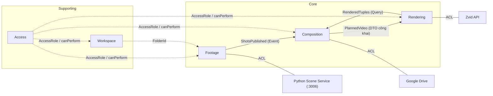

# Bounded Contexts & Context Map

## 1. Phân loại context

| Context         | Vai trò    | Mức DMMF               | Trách nhiệm chính                                                                                       |
| --------------- | ---------- | ---------------------- | ------------------------------------------------------------------------------------------------------- |
| **Footage**     | Core       | Đầy đủ                 | Upload `SourceVideo`, phát hiện `Scene`, chỉnh sửa/phân loại `Shot`, cắt và publish sang thư viện       |
| **Composition** | Core       | Đầy đủ                 | Quản lý `ClipLibrary`, `VoiceClip`, ingest từ Drive/Excel, chạy thuật toán `planMix` tạo `PlannedVideo` |
| **Rendering**   | Core       | Đầy đủ (state machine) | Validate, submit và theo dõi `RenderJob` trên Zvid, quản lý `RenderedRecord` (history)                  |
| **Access**      | Supporting | Vừa                    | Xác thực `Actor`, quản lý `Share`, tính `AccessRole` và kiểm tra quyền `canPerform`                     |
| **Workspace**   | Generic    | Nhẹ                    | CRUD `Project` và `Folder`, điều hướng studio shell                                                     |

## 2. Context Map

## 3. Shared Kernel (`src/contexts/shared-kernel`)

Chỉ chứa các kiểu giá trị tối thiểu dùng chung giữa các context:

- Branded IDs: `ProjectId`, `FolderId`, `UserId`, `SourceVideoId`, `ShotId`, `ClipId`, `VoiceId`, `RenderJobId`
- Value objects: `ShotCategory`, `Seconds`, `MediaUrl`, `LocalPath`, `ContentHash`

Mọi thay đổi vào `shared-kernel` ảnh hưởng tất cả context, nên giữ kích thước nhỏ nhất có thể.
