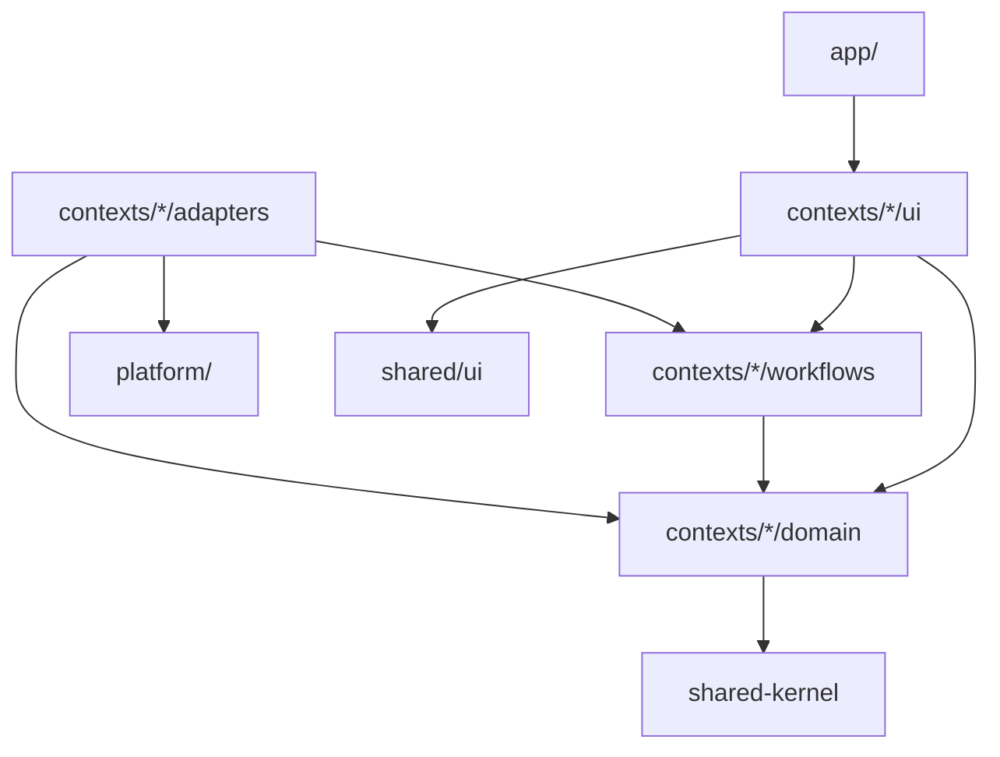
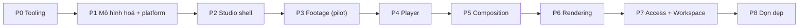

# Lachvid Studio: master plan refactor Next.js (v3 – DMMF + FP)

> [!NOTE]
> Giải thích chi tiết DMMF áp dụng ở đâu và như thế nào: xem [ARCHITECTURE.md](../ARCHITECTURE.md). File này chỉ là lộ trình.

## 0. Các quyết định đã chốt

| #   | Quyết định                                                                                                                     |
| --- | ------------------------------------------------------------------------------------------------------------------------------ |
| 1   | **Domain Modeling Made Functional (thực dụng)** + **Functional Programming**: đầy đủ cho context core, nhẹ cho context generic |
| 2   | **Effect TS** cho workflow, DI (`Context`/`Layer`), lỗi; **Effect Schema thay Zod**                                            |
| 3   | **yarn**, **Tailwind v4 + HeroUI v3**, **SQL thô** bọc trong adapter                                                           |
| 4   | Coverage **theo phase / context / layer**                                                                                      |
| 5   | Refactor **tại chỗ, tuần tự**, mỗi stage = 1 PR nhỏ, luôn build & chạy được                                                    |
| 6   | Python backend giữ nguyên, Next.js gọi qua adapter có anti-corruption layer                                                    |

---

## 1. Bounded contexts

| Context                                          | Loại       | Mức DMMF              | Nguồn code hiện tại                                                                     |
| ------------------------------------------------ | ---------- | --------------------- | --------------------------------------------------------------------------------------- |
| **Footage** (tách video)                         | Core       | Đầy đủ                | tab `split` trong `StudioWorkspace`, `detect-scenes`, `slice-scenes`, `store.ts`        |
| **Composition** (thư viện clip, voice, plan mix) | Core       | Đầy đủ                | tab `mix`, `planner.ts`, `category-library`, `plan-mix`, `drive.ts`                     |
| **Rendering** (render job, lịch sử)              | Core       | Đầy đủ, state machine | `render-composed`, `zvid`, `zvid.ts`, `webhooks/zvid`, tab `history`                    |
| **Access** (user, phiên, share, quyền)           | Supporting | Vừa                   | `auth.ts`, `password.ts`, `PermissionGate`, `ShareProjectModal`, `db.ts` (users/shares) |
| **Workspace** (project, folder)                  | Generic    | Nhẹ                   | `page.tsx`, `projects/[id]/page.tsx`, `db.ts` (projects)                                |

Shared kernel (dùng chung, rất nhỏ): `ShotCategory`, `Seconds`, `MediaRef`, các branded ID.

---

## 2. Kiến trúc đích

### 2.1 Cấu trúc thư mục

```
src/
├── app/                                  # CHỈ routing Next.js (page/layout/loading/error/route)
├── contexts/
│   ├── shared-kernel/                    # type dùng chung giữa các context
│   ├── footage/
│   │   ├── domain/                       # type + hàm thuần (Schema, Data, Option, Either). KHÔNG I/O, KHÔNG Effect service
│   │   │   ├── types.ts                  # SourceVideo, Shot (DraftShot | ClassifiedShot), TimeRange, ShotEdits
│   │   │   ├── shot.ts                   # splitAt, mergeWith, trim, setSpeed, classify...
│   │   │   ├── errors.ts                 # lỗi domain (TaggedError)
│   │   │   └── events.ts                 # ShotsDetected, ShotsPublished...
│   │   ├── workflows/                    # Effect.gen: load → domain → persist → events
│   │   │   ├── detect-scenes.ts
│   │   │   ├── publish-shots-to-library.ts
│   │   │   └── ports.ts                  # Context.Tag: FootageRepo, SceneDetector, Slicer
│   │   ├── adapters/                     # Layer hiện thực port: SQL, Python, file system; DTO ↔ domain
│   │   ├── ui/                           # component, hook, reducer, server action mỏng
│   │   └── index.ts                      # public API của context
│   ├── composition/   rendering/   access/   workspace/
├── platform/                             # hạ tầng không thuộc domain
│   ├── runtime.ts                        # ManagedRuntime + AppLayer
│   ├── run.ts                            # runQuery / makeAction / runRoute
│   ├── config.ts                         # Config + Schema env
│   ├── sql/                              # SqlClient (bọc @sqlitecloud/drivers + local fallback)
│   └── http/                             # HttpClient chung (timeout, retry)
├── shared/
│   ├── ui/                               # wrapper HeroUI
│   └── lib/                              # util thuần
└── proxy.ts
```

### 2.2 Quy tắc phụ thuộc (enforce bằng `eslint-plugin-boundaries`)



- `domain` chỉ được import `shared-kernel` và `effect` (Schema/Data/Option/Either/Match/Array). Cấm `Effect` có requirement, cấm `fetch`, `fs`, `Date.now()`, `Math.random()`.
- `workflows` chỉ biết **port** (`Context.Tag`), không biết adapter cụ thể.
- `adapters` là nơi duy nhất chạm SQL, Python, Zvid, Drive, file system.
- Context A chỉ dùng context B qua `B/index.ts` hoặc qua event; không import sâu.
- `AppLayer` trong `platform/runtime.ts` là nơi duy nhất ghép adapter vào port.

### 2.3 Ranh giới server action vs route handler

| Giữ route handler                                          | Chuyển sang server action (gọi workflow)                  |
| ---------------------------------------------------------- | --------------------------------------------------------- |
| `media/[...path]`, `drive-stream/[fileId]` (stream, Range) | `project`, `project/[id]`, `parent-projects/*`, `users`   |
| `webhooks/zvid` (bên ngoài gọi vào)                        | `detect-scenes`, `slice-scenes`                           |
| `render-progress` (polling, tránh chặn hàng đợi action)    | `plan-mix`, `category-library`, `render-composed`, `zvid` |
| `upload-local` (file tới 500MB)                            | `auth/*` (`auth/me` → RSC)                                |

---

## 3. Lộ trình



### P0 – Nền tảng tooling (4 stage)

- **P0.1 Package & config**: [x] xoá `package-lock.json`, `packageManager: yarn`, Node 22 LTS; gỡ `tsconfig.tsbuildinfo`, `studio.patch`, `dev.log` khỏi git; `tsconfig` ES2022 + `noImplicitOverride` (+ `tsconfig.strict.json` với `noUncheckedIndexedAccess` & `exactOptionalPropertyTypes`); script `typecheck`
- **P0.2 Lint & format**: [x] ESLint flat (`eslint-config-next` + `typescript-eslint` strict-type-checked + `boundaries` + `simple-import-sort` + `eslint-plugin-functional` cho `domain/**`); cấm `zod`, cấm `fetch("/api` trong client; code cũ ở mức `warn`; Prettier + `prettier-plugin-tailwindcss`; `husky` + `lint-staged`
- **P0.3 Test**: [x] Vitest (`happy-dom` sẵn sàng cho UI, `node` mặc định) + Testing Library + `@effect/vitest` + `fast-check` + coverage v8 (threshold theo glob); Playwright + smoke test
- **P0.4 Framework & thư viện**: [x] `middleware.ts` → `proxy.ts`; Tailwind v4 + HeroUI v3; cài `effect` (4.1.4), `react-hook-form`, `@hookform/resolvers`, `nuqs`; GitHub Actions (lint → typecheck → test → build); **AGENTS.md v1**

**Exit**: CI xanh, app chạy như cũ, giao diện không vỡ.

### P1 – Mô hình hoá domain + platform (5 stage)

- **P1.0 Mô hình hoá** (tài liệu, chưa đổi code chạy): [x]
  - `docs/domain/glossary.md` (ngôn ngữ chung, bảng đổi tên: `project` trong code → `Folder`, `parent project` → `Project`)
  - `docs/domain/context-map.md`
  - `docs/domain/workflows.md`: chữ ký workflow dạng `Command → Result<Events, Errors>`
  - `contexts/shared-kernel` + `contexts/{footage,composition,rendering}/domain/types.ts` (type + Schema + test cho Schema)
- **P1.1 Platform**: [x] `config.ts` (bỏ secret fallback production), `errors.ts`, `runtime.ts`, `run.ts` (`runQuery`, `makeAction`, `runRoute`), test mapping lỗi & config
- **P1.2 SQL**: [x] `SqlClient` (`src/platform/sql`); tách `db.ts` thành adapter repository theo context sẽ tiếp tục ở P3–P7 khi migrate từng context
- **P1.3 Anti-corruption layers**: [x] `HttpClient` (`src/platform/http`), `MediaStorage` (`src/platform/storage`, fix path traversal); các ACL cụ thể (`PythonSceneDetector`, `ZvidClient`, `DriveClient`) đặt trong `contexts/*/adapters/` ở P3–P6
- **P1.4 Shared UI**: [x] `shared/ui` (`Button`, `IconButton`, `Modal`, `ConfirmDialog`, `FormField`, `TextInput`, `EmptyState`, `Spinner`) + hook `useActionForm`

**Exit**: glossary + context map được bạn duyệt; `platform/**` ≥ 80%; `domain/types` của 3 context core có test Schema.

### P2 – Studio shell (3 stage)

- **P2.1** [x] Page folder → RSC load access + folder; tab qua `nuqs`
- **P2.2** [x] `contexts/workspace/ui/studio-shell`: `StudioShell`, `useStudioTab`, `ToastProvider`, `PermissionProvider` (dùng `Access` domain `canPerform`/`AccessRole`)
- **P2.3** [x] Mount `StudioWorkspace` cũ bên trong `StudioShell` như "legacy tab"

**Exit**: shell chạy, `studio-shell` ≥ 70%.

### P3 – Footage context (pilot, 4 stage)

- **P3.1 Domain**: [x] `DraftShot | ClassifiedShot`, `TimeRange`, `Speed`, `ZoomDepth`; hàm thuần `splitShotAt`, `mergeShotWithNext`, `trimShot`, `toggleShotFlip`, `setShotSpeed`, `setShotZoom`, `classifyShot`, `applyMinDuration`, `groupScenesIntoShots`. Characterization test từ hành vi cũ + property test
- **P3.2 Workflows + adapters**: [x] `detectScenes`, `sliceShots`, `ports.ts`; `PythonSceneDetectorLive` + `shotFromLegacyDto`/`shotToLegacyDto` ACL (còn lại `publishShotsToLibrary`, `SliceActions` & xoá route cũ ở P3.4)
- **P3.3 UI**: [x] `footageReducer` gọi hàm domain; `ShotList` dùng `shared/ui` (còn `SourceUploader`, `ShotEditorPanel` & mount thay thế vào `StudioWorkspace` ở P3.4)
- **P3.4** [x] Hoàn thiện `SplitTab` (`ShotEditorPanel`, `SliceActions`, `publishShotsToLibrary` workflow + `PythonShotSlicerLive` + `SessionFootageRepoLive` + Server Actions `detectScenesAction`/`sliceShotsAction`/`publishShotsAction`), test đạt toàn bộ ngưỡng module (gỡ bỏ code split khỏi `StudioWorkspace` & xoá route cũ thực hiện cùng lúc khi nối Player + Mix ở P4–P5 để giữ app chạy liên tục)

**Exit**: `footage/domain` ≥ 90% (có property test), `workflows` ≥ 85%, `adapters` ≥ 70%, `ui` ≥ 60%.

> [!TIP]
> Sau P3: retro, chỉnh lại pattern và AGENTS.md trước khi nhân rộng.

### P4 – Player (2 stage)

- **P4.1** [x] Tính timeline/tốc độ phát/slot → hàm thuần trong `composition/domain/timeline.ts`; tách hook `usePlaybackTimeline`
- **P4.2** [x] Tách logic trim thuần → `footage/domain/trim.ts` + hook `useTrimHandles` (có property-based test)

**Exit**: `timeline` ≥ 90%, hooks ≥ 70%.

### P5 – Composition context (4 stage)

- **P5.1 Domain**: [x] `planner.ts` → `composition/domain/planner.ts` (stateless seeded Mulberry32, thuần bất biến) + `drive-parser.ts` + characterization test với seed cố định + property test (Hamming)
- **P5.2 Workflows + adapters**: [x] `planMix`, `onShotsPublished` (handler event `ShotsPublished` từ Footage), `ports.ts` (`ClipLibraryRepo`, `VoiceLibraryRepo`, `RenderedTuplesQuery`, `PlannedVideoRepo`)
- **P5.3 UI**: [x] `DiversityRulesForm` (RHF + `useActionForm` + Effect Schema + `shared/ui`)
- **P5.4** [x] Hoàn thiện `MixTab` (`ClipLibraryBoard`, `VoiceLibrary`, `ingestDriveLinks` adapter + Server Actions); gỡ legacy `plan-mix`, `category-library` cùng với `StudioWorkspace` ở P6.3

**Exit**: `composition/domain` ≥ 90%, `workflows` ≥ 85%, `ui` ≥ 60%.

### P6 – Rendering context (3 stage)

- **P6.1 Domain + workflows**: [x] state machine `RenderJob` (`Draft → Validated → Submitted → Running → Succeeded | Failed`), `RenderedRecord`; workflow `applyProviderUpdate` (dùng chung cho webhook + polling), `markRecordUsed`; `ZvidGatewayLive` ACL + `verifyZvidWebhookSignature`
- **P6.2 History UI**: [x] `HistoryList` dùng `shared/ui` (`Button`, `IconButton`, `EmptyState`)
- **P6.3** [x] E2E render (mock Zvid/Python) + `HistoryTab` + `StudioWorkspaceView` thay thế hoàn toàn `StudioWorkspace.tsx` & `ShareProjectModal.tsx`, gỡ các API route cũ (chỉ giữ 5 nhóm route ở bảng 2.3)

**Exit**: `rendering/domain` ≥ 90%, `workflows` ≥ 85%.

### P7 – Access + Workspace (3 stage)

- **P7.1 Access**: [x] `AccessRole`, `ModulePermission`, `canPerform` thuần; `LoginInput`/`RegisterInput` Schemas, `loginWorkflow`/`registerWorkflow`/`logoutWorkflow`, `LoginForm` (`useActionForm`), `verifySessionToken` dùng chung trong `proxy.ts`
- **P7.2 Workspace**: [x] `CreateProjectInput`/`RenameProjectInput`/`CreateFolderInput`/`RenameFolderInput` Schemas, `CreateProjectDialog` dùng `Modal` + `FormField` + `useActionForm`
- **P7.3 Sharing & RSC pages**: [x] chuyển `/login` (`AuthScreen` + `loginAction`/`registerAction`), `/` (`ProjectsDashboard` + `createProjectAction`/`deleteProjectAction`/`logoutAction`), `/projects/[id]` (`ProjectFoldersView` + `FolderRepoLive` + `createFolderAction`/`renameFolderAction`/`deleteFolderAction`), và `ShareProjectModal` (`ShareRepoLive` + `listProjectSharesAction`/`shareProjectAction`/`removeProjectShareAction`) sang RSC / Server Actions + HeroUI `Modal`

**Exit**: chỉ còn 5 route ở bảng 2.3; `access/domain` ≥ 90%, actions ≥ 80%.

### P8 – Dọn dẹp (2 stage)

- **P8.1** [x] Xoá `src/components/*`, `src/lib/planner.ts`, `src/lib/drive.ts` và bỏ toàn bộ phụ thuộc `@/lib/*` / `@/types/lachvid` trong `src/contexts/**`; nâng `simple-import-sort` `warn` → `error` (giữ `src/lib/{auth,db,store,zvid,password}.ts` & `src/types/lachvid.ts` ở mức tối thiểu cho 5 route/RSC adapter còn lại)
- **P8.2** [x] Bật threshold toàn cục ≥ 75% trong `vitest.config.mts`, E2E trong CI, cập nhật README & **AGENTS.md bản cuối**

---

## 4. Coverage theo layer

| Layer                  | Ngưỡng                  | Kỹ thuật test                                                        |
| ---------------------- | ----------------------- | -------------------------------------------------------------------- |
| `contexts/*/domain`    | 90%                     | unit + **property-based** (`fast-check`, `Arbitrary` sinh từ Schema) |
| `contexts/*/workflows` | 85%                     | `@effect/vitest` + **test Layer** in-memory cho port                 |
| `contexts/*/adapters`  | 70%                     | integration (SQLite in-memory, HTTP mock) + test mapping DTO         |
| `contexts/*/ui`        | 60%                     | Testing Library; reducer test như hàm thuần                          |
| `platform/**`          | 80%                     | unit                                                                 |
| E2E                    | luồng chính mỗi context | Playwright                                                           |

Ngưỡng của context chỉ bật khi tới phase của context đó.

---

## 5. Nội dung thêm vào AGENTS.md

1. Bounded context, cấu trúc thư mục, quy tắc phụ thuộc (mục 1, 2.1, 2.2)
2. **Ngôn ngữ chung**: tên type/hàm/file theo `docs/domain/glossary.md`, không dùng tên kỹ thuật chung chung (`data`, `item`, `info`, `manager`)
3. **Make illegal states unrepresentable**: union theo trạng thái thay cho cờ boolean/field optional; branded type cho giá trị có ràng buộc; `Option` thay `null | undefined` trong domain
4. **Workflow**: viết chữ ký trước, dạng pipeline `Unvalidated → Validated → decide → Events`; lỗi nghiệp vụ là giá trị
5. **FP**: `domain` thuần, bất biến (`readonly`, `ReadonlyArray`), không class (trừ `Data`/`TaggedError`), không `let` mutation, xử lý exhaustive bằng `Match`; thời gian và random truyền vào như tham số
6. Effect: port = `Context.Tag`, adapter = `Layer`, chỉ chạy Effect qua `runQuery`/`makeAction`/`runRoute`; cấm `throw`
7. Effect Schema là nguồn duy nhất cho type + validation; **cấm Zod**; DTO và domain là 2 schema khác nhau
8. Server-first: mặc định RSC, `"use client"` chỉ ở lá; mutation dùng server action; danh sách route handler được phép
9. Form: RHF + `effectTsResolver` qua `useActionForm`; URL state dùng `nuqs`; UI chỉ dùng `shared/ui`
10. Test: thay đổi `domain`/`workflows`/`adapters` phải kèm test, đạt ngưỡng layer
11. Named export (trừ `page`/`layout`), file ≤ 300 dòng
12. Trước khi xong việc: `yarn lint && yarn typecheck && yarn test`
13. Next 16: `proxy.ts`, `params`/`searchParams` là Promise, đọc docs trong `node_modules/next/dist/docs/`

---

## 6. Rủi ro

| Rủi ro                         | Cách giảm                                                                        |
| ------------------------------ | -------------------------------------------------------------------------------- |
| Over-engineering               | Mức DMMF theo bảng mục 1; Workspace chỉ dùng Schema + adapter                    |
| Nhiều boilerplate DTO ↔ domain | `Schema.transform`/`transformOrFail` sinh mapping 2 chiều; template mẫu trong P3 |
| Đường học Effect + DMMF        | P3 là pilot + retro; ví dụ chuẩn trong AGENTS.md và `docs/ARCHITECTURE.md`       |
| Hành vi cũ bị đổi              | Characterization test trước khi chuyển; legacy tab chạy song song                |
| Tailwind v4 vỡ giao diện       | PR riêng ở P0.4, so ảnh chụp trước/sau                                           |
| API Effect 3.x vs 4.x          | Chốt phiên bản lúc cài ở P0.4                                                    |
